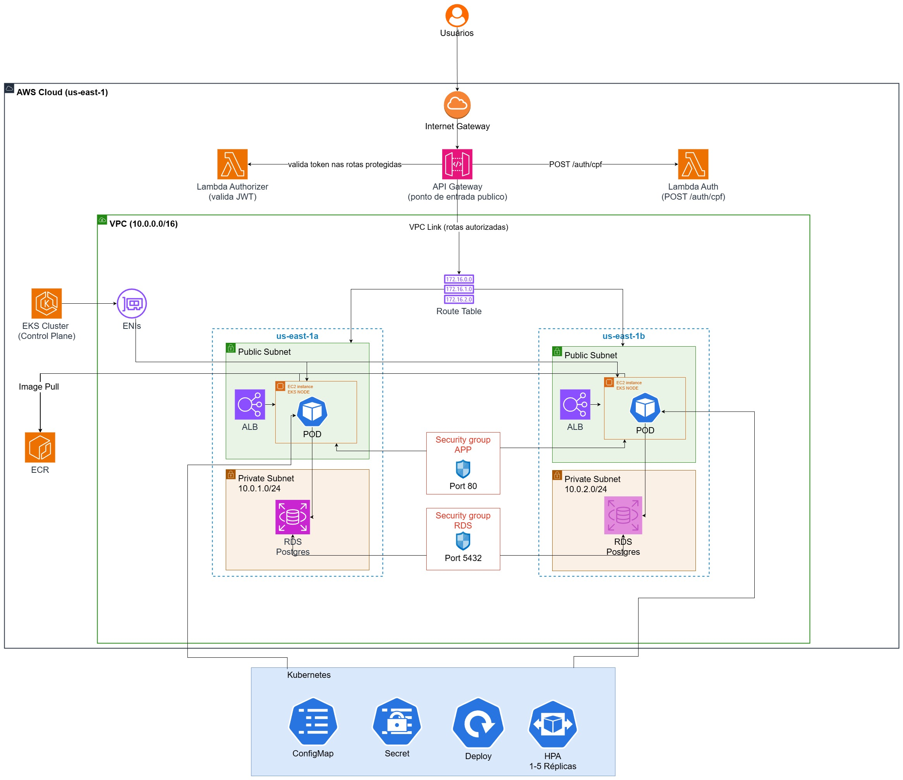
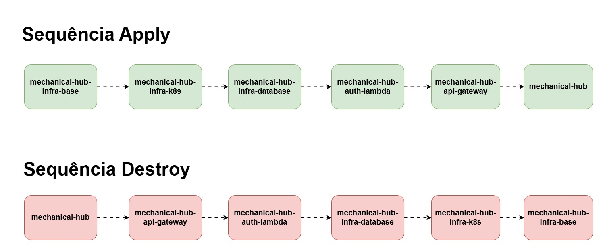

# mechanical-hub-auth-lambda

Lambda que autentica o **cliente** do mechanical-hub por CPF + placa (sem senha),
emitindo um JWT próprio de cliente. É o fluxo de autenticação separado do login
de e-mail/senha da equipe interna, que continua sendo feito pela própria aplicação
Spring.

## Tecnologias

- **Python 3.12** (runtime da Lambda).
- **pg8000** — driver PostgreSQL puro Python (sem dependência nativa/C, importante para empacotar a Lambda sem camadas extras).
- **PyJWT** — emissão do JWT do cliente.
- **Terraform** (`hashicorp/aws ~> 5.0`) — função Lambda, empacotamento via `archive_file`, dentro da VPC.
- **GitHub Actions** — instala as dependências Python, empacota e aplica/destrói via Terraform.

## Diagrama de arquitetura



VPC, subnets, security groups, EKS, RDS, API Gateway, Lambdas e Datadog no contexto
de toda a infraestrutura — esta Lambda aparece como "Lambda Auth (POST /auth/cpf)".

## Passos para execução e deploy

**Depende do `infra-base` e do `infra-database` já aplicados** — não é só
convenção: `data.aws_db_instance.main` busca a instância RDS pelo identificador,
então o `terraform apply` falha se o banco ainda não existir. Também consome a
subnet privada e o security group `lambda_auth` do `infra-base`. Ordem completa:
infra-base → infra-k8s → infra-database → **auth-lambda** → api-gateway →
`mechanical-hub` (app). Para derrubar, ordem inversa, saindo antes do
`infra-database`.



1. Configurar no repositório os secrets `AWS_ACCESS_KEY_ID`, `AWS_SECRET_ACCESS_KEY`,
   `AWS_SESSION_TOKEN`, `AWS_ACCOUNT_ID`, `DB_PASSWORD` e `JWT_SECRET` (precisa ser
   **o mesmo valor** configurado no repo `mechanical-hub`, já que os dois emitem
   JWT validados pelo mesmo segredo).
2. Garantir que `infra-base` e `infra-database` já foram aplicados.
3. No início da sessão do AWS Academy, garantir `infra/pipeline.conf` com
   `DESTROY=false` e fazer merge em `main` via PR (branch protegida, sem push
   direto), ou disparar `workflow_dispatch` manualmente.
4. A pipeline instala as dependências Python em `src/` (`pip install -r
   requirements.txt -t .`), empacota o zip via Terraform e aplica a função Lambda.
5. Conferir os outputs `lambda_arn` e `lambda_function_name` — é isso que o
   `api-gateway` consome para integrar a rota `POST /auth/cpf`.
6. Antes da sessão do AWS Academy encerrar, mudar `infra/pipeline.conf` para
   `DESTROY=true` e fazer merge em `main` via PR.

## Decisões arquiteturais relacionadas

RFCs e ADRs ficam centralizados no repo da aplicação, para não duplicar/desincronizar entre os 6 repositórios. As diretamente relevantes para este repo:

- [RFC-003 — Estratégia de autenticação: dois fluxos coexistindo](https://github.com/estefanyneres/mechanical-hub/blob/main/src/docs/fase3/documentacao/rfcs.md)
- [RFC-004 — Lambda authorizer validando na borda, mantendo Spring Security como defesa em profundidade](https://github.com/estefanyneres/mechanical-hub/blob/main/src/docs/fase3/documentacao/rfcs.md)
- [ADR-002 — Descoberta entre repositórios via data source](https://github.com/estefanyneres/mechanical-hub/blob/main/src/docs/fase3/documentacao/adrs.md)
- [ADR-007 — Runtime da Lambda justificado pelo teto de simultaneidade](https://github.com/estefanyneres/mechanical-hub/blob/main/src/docs/fase3/documentacao/adrs.md)

## Como a autenticação funciona

`POST` com `{ "cpf": "...", "placa": "..." }` no corpo. O CPF é validado por
algoritmo real (dígitos verificadores), não só formato. Se válido, busca no banco
um cliente cujo CPF bate com um veículo daquela placa (`JOIN customers` +
`vehicles`); sem correspondência, `401`. Encontrando, emite um JWT com
`sub = customerId`, `type = "customer"` e **15 minutos de expiração** — bem mais
curto que o token da equipe interna (2h), coerente com um fluxo de autoatendimento
pontual, não uma sessão de trabalho.

## Por que a Lambda fica dentro da VPC

Ela conecta direto no RDS (`pg8000`, sem passar pela aplicação Spring), então
precisa estar na mesma rede — daí o `vpc_config` com a subnet privada e o SG
`lambda_auth`, ambos consumidos via data source do `infra-base`.

## Outputs publicados

| Output                 | Descrição                                         |
|--------------------------|------------------------------------------------------|
| `lambda_arn`            | ARN da Lambda, usado pelo `api-gateway` para integrar |
| `lambda_function_name`  | Nome da função Lambda                              |

## Pipelines

- `pipeline-infra-feature.yml`: dispara em push para `feature/*`. Roda
  `terraform fmt -check`, `init -backend=false` e `validate`. Abre PR automático
  para `main` se tudo passar.
- `pipeline-infra-main.yml`: dispara em push para `main` (ou `workflow_dispatch`).
  Instala as dependências Python, lê `infra/pipeline.conf` e aplica ou destrói o
  Terraform conforme `DESTROY`, passando `aws_account_id`, `db_password` e
  `jwt_secret` via `-var`.

## Estrutura

```
mechanical-hub-auth-lambda/
├── .github/workflows/
│   ├── pipeline-infra-feature.yml
│   └── pipeline-infra-main.yml
├── docs/
│   └── desenhos/
│       ├── mechanical-hub-infraestrutura-fase-03.jpg
│       └── mechanical-hub-apply-destroy-repos-fase-03.jpg
├── infra/
│   ├── providers.tf
│   ├── variables.tf
│   ├── data.tf
│   ├── lambda.tf
│   ├── outputs.tf
│   └── pipeline.conf
├── src/
│   ├── lambda_function.py
│   └── requirements.txt
├── .gitignore
└── README.md
```
